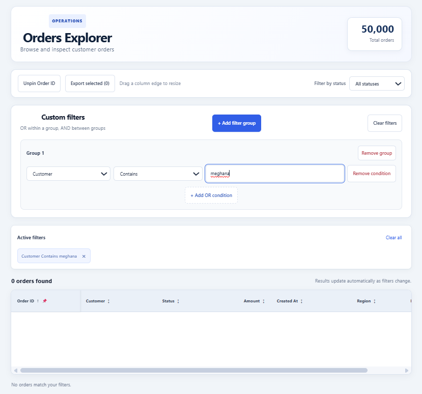
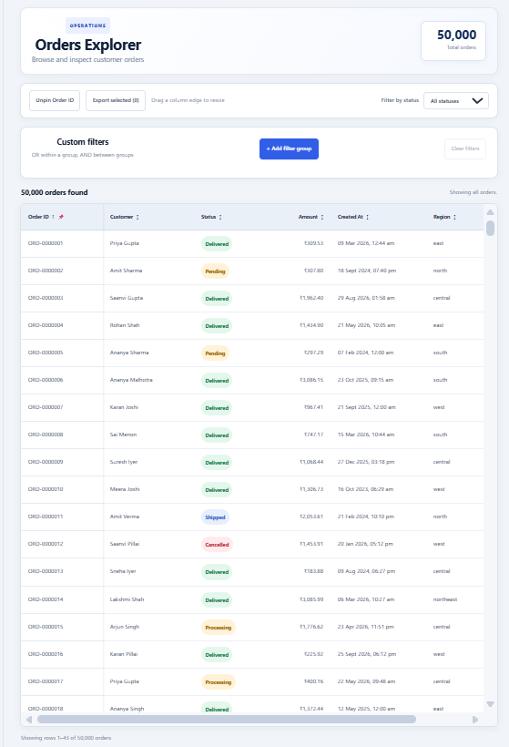
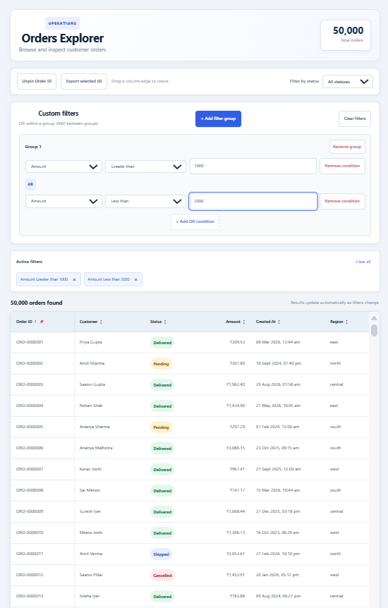
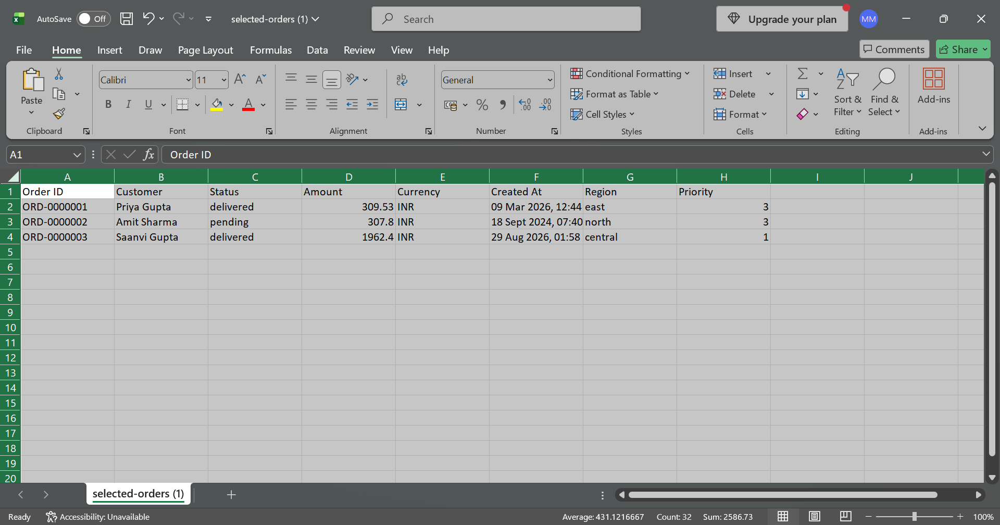

# Orders Explorer

Orders Explorer is a React and TypeScript web application for exploring, filtering, sorting, and exporting a large dataset of 50,000 orders.

## Features

- **Data normalization:** Cleans and standardizes order records from different schema versions.
- **Virtualized table:** Displays large datasets efficiently.
- **Sorting:** Sorts orders by supported columns.
- **Column resizing and pinning:** Adjusts column widths and keeps selected columns visible.
- **Row selection:** Supports individual selection and Shift-click range selection.
- **Keyboard navigation:** Navigate through the grid using the keyboard.
- **Order details:** View detailed information about a selected order.
- **Custom filter builder:** Build filters using field-specific operators.
- **Filter groups:** Supports OR conditions within a group and AND conditions between groups.
- **Filter chips:** View and remove applied filters.
- **Live result count:** Shows the number of orders matching the current filters.
- **Empty state:** Displays a message when no orders match the filters.
- **URL state persistence:** Stores supported grid settings in the URL.
- **CSV export:** Exports selected orders to a CSV file.
- **Indian currency formatting:** Displays amounts in INR format, such as ₹1,23,456.50.

## Tech Stack

- React 19 — Builds the user interface.
- TypeScript — Provides static type checking.
- Vite — Runs the development server and builds the application.
- CSS — Styles the grid, filter builder, and other interface elements.

## Dependencies

### Runtime Dependencies

- `react` — Creates the component-based user interface.
- `react-dom` — Renders React components in the browser.

### Development Dependencies

- `vite` — Provides the development server and production build tools.
- `@vitejs/plugin-react` — Integrates React with Vite.
- `typescript` — Checks TypeScript types and compiles the project.
- `tsx` — Runs TypeScript scripts during development.
- `eslint` — Checks code for potential problems.
- `@eslint/js`, `typescript-eslint`, `eslint-plugin-react-hooks`, `eslint-plugin-react-refresh`, and `globals` — Support linting and React-specific code checks.
- `@types/node`, `@types/react`, and `@types/react-dom` — Provide TypeScript type definitions.


## Requirements

- Node.js 24 or a compatible version
- npm
- Git

## Getting Started

### 1. Clone the repository

```bash
git clone https://github.com/mogilimeghana/orders-explorer.git
cd orders-explorer
```

### 2. Install dependencies

```bash
npm install
```

### 3. Start the development server

```bash
npm run dev
```

Open the local URL displayed in the terminal, usually:

```text
http://localhost:5173/
```

## Validation

Run the TypeScript check:

```bash
npx tsc --noEmit -p tsconfig.app.json
```

Build the application:

```bash
npm run build
```

Both commands completed successfully during development. The production build reports a large JavaScript bundle warning, which may be addressed through further code-splitting and bundle optimization.

## Data Normalization

The application processes the provided `orders.json` dataset.

- The raw dataset contains 50,030 records.
- Duplicate order IDs are removed, leaving 50,000 unique orders.
- Schema version 1 stores amounts in paise. These amounts are converted to rupees by dividing by 100.
- Schema version 2 stores amounts in rupees and does not require this conversion.
- Currency values are trimmed to remove unwanted whitespace.
- Missing or optional values are handled during normalization.
- Amounts are displayed, sorted, and filtered consistently in rupees.
- Currency values are displayed using Indian currency formatting.

## Data Loading

The application loads the provided `orders.json` dataset locally in the frontend and normalizes the records before displaying them. This avoids the need for a backend or API.

## Design Changes

The design sketches were created before implementation to plan the main grid and empty state. The final application includes the grid, filter builder, and CSV export functionality. The screenshots in this README show the implemented interface.

## CSV Export

Users can select orders and export them as a CSV file.

The export supports selected orders even when those orders are hidden by the currently applied filters.

## Design Files

Design sketches are stored in the `design/` directory.

- `design/main-grid.png`
- `design/empty-state.png`
- `design/main-grid.md`
- `design/empty-state.md`

## Application Screenshots

### Empty State



### Main Orders Grid



### Custom Filters



### CSV Export



## Known Limitations

- The production build reports a large JavaScript bundle warning.
- Keyboard navigation, URL state restoration, and all filter combinations should receive final manual verification before submission.

## Repository

GitHub: https://github.com/mogilimeghana/orders-explorer
